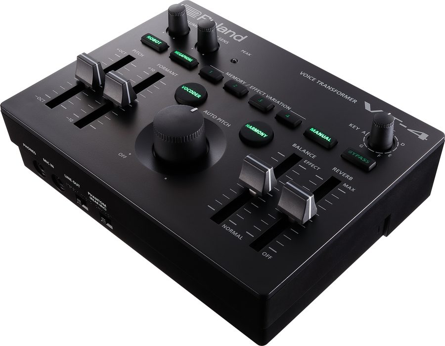
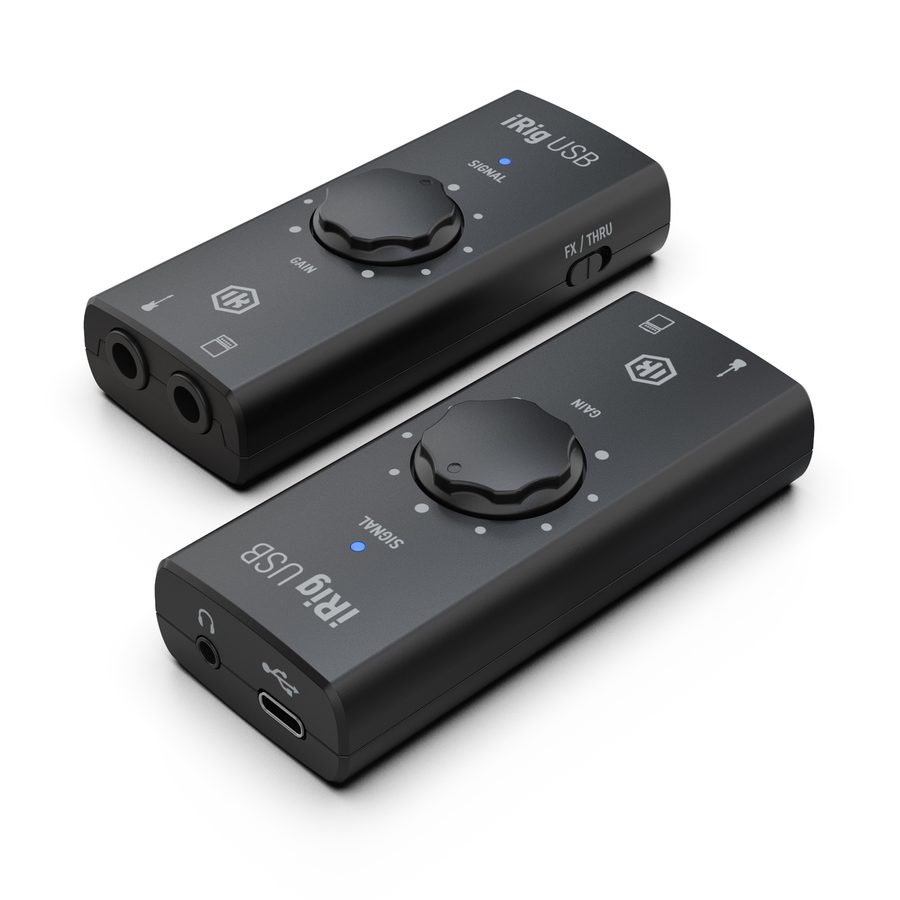
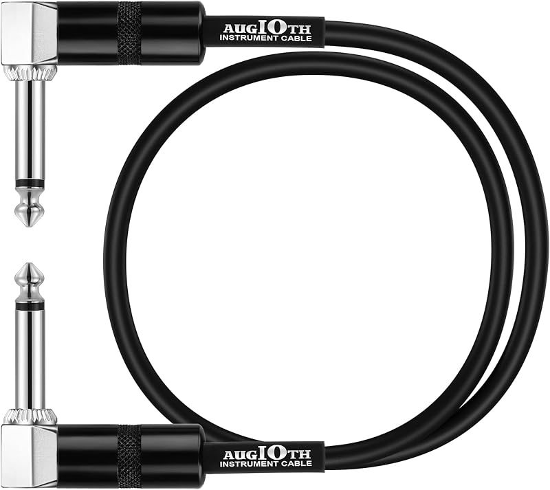
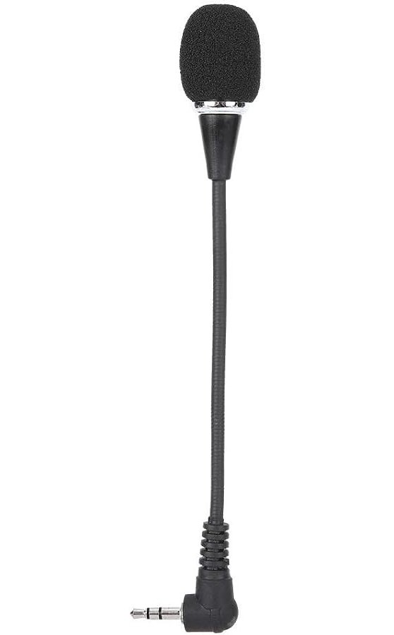
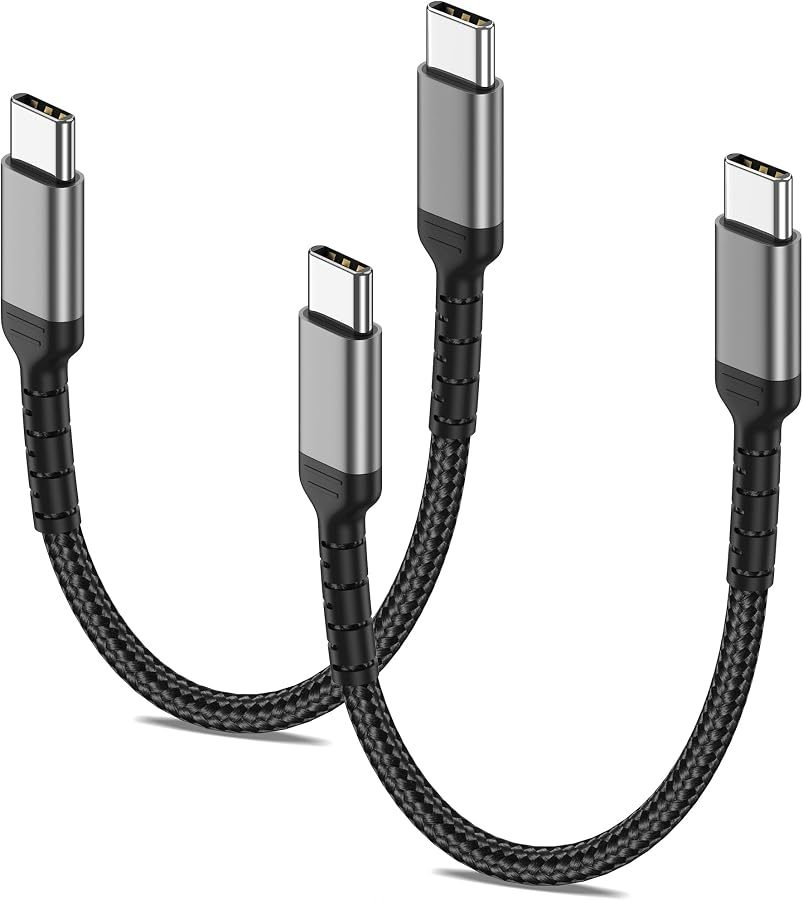
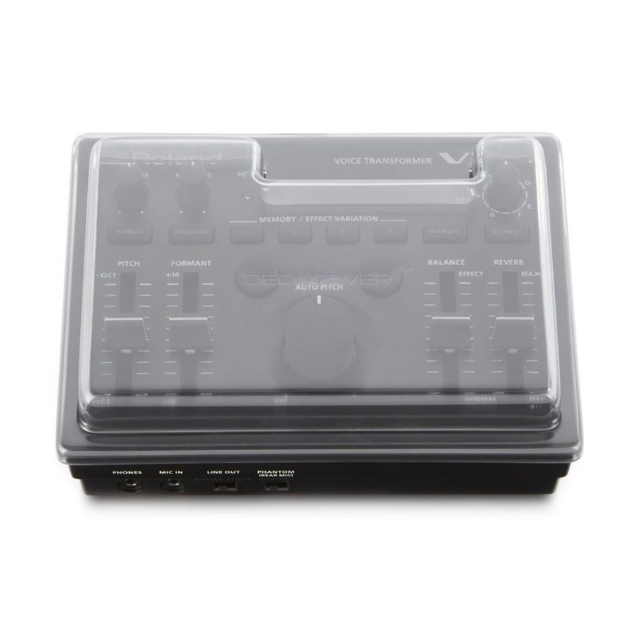
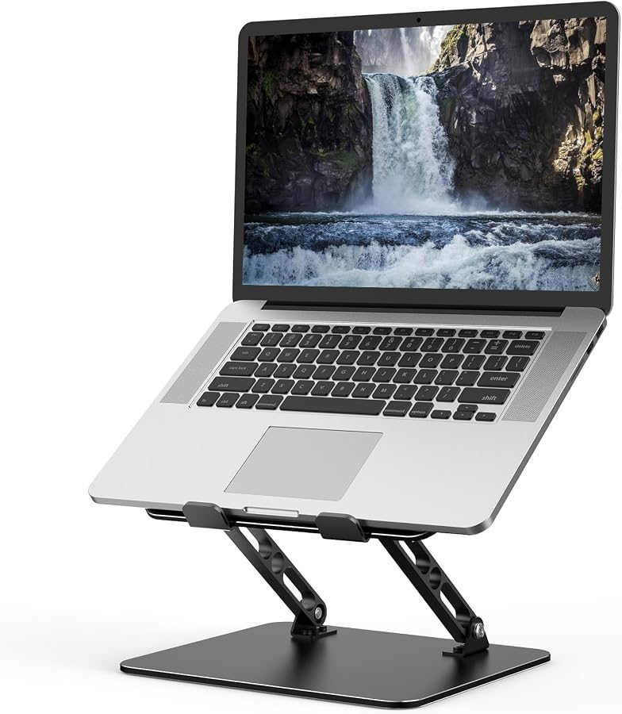
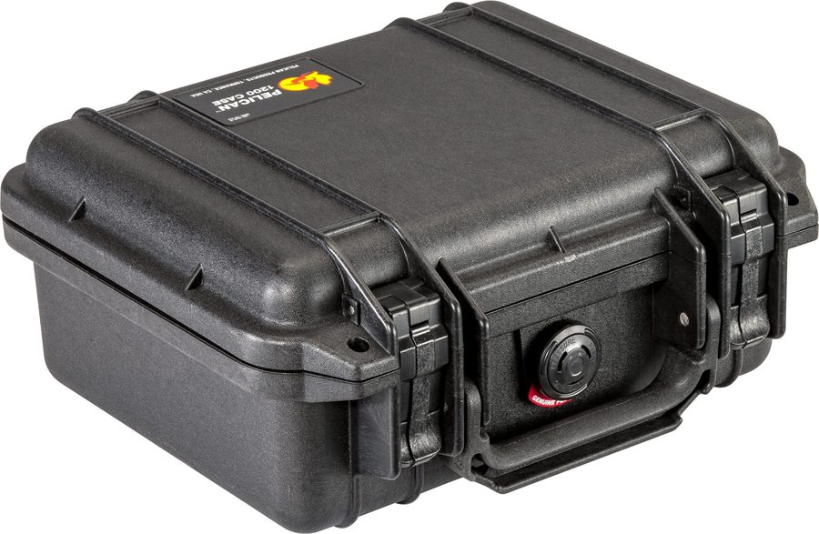

# FrankenVish

Hardware bill of materials for FrankenVish, the vishing device formerly called "The Thing."

Items 1–5 are the core audio path: a microphone into the Roland VT-4, a short patch cable into the iRig USB, then a short USB-C cable to the host. A–D are optional cover, mounting, and transport pieces.

Product photos are the manufacturers' or retailers' product images, saved in `images/` and credited to the product page they came from. Those photos are not covered by the MIT license on this repo.

### 1. Roland VT-4 — Voice transformer

This is the voice-shaping box. Pitch and formant each have a slider, and the panel has robot, megaphone, vocoder, harmony, and reverb, with no menus to dig through. The front MIC IN is a 3.5 mm jack with plug-in power, which is where the mini microphone goes. The rear LINE OUT jacks are 1/4 inch, labeled L/MONO and R/BYPASS. L/MONO is the one that feeds the patch cable.

It runs on USB bus power or four AA batteries. Roland rates alkaline batteries at about six hours with phantom power off, and about four hours with it on.

[Roland product page](https://www.roland.com/global/products/vt-4/) · Product photo: [Roland VT-4](https://www.roland.com/global/products/vt-4/)

### 2. IK Multimedia iRig USB — USB-C interface

Pocket interface, model IP-IRIG-USB-IN. The host port is USB-C, the converters are 24-bit at 44.1 or 48 kHz, and the 1/4 inch instrument input has a gain knob and a clip light. The host powers it. The VT-4's L/MONO line output plugs into that 1/4 inch jack, and USB-C carries the audio to a computer or phone. IK includes a 60 cm USB-C cable. Item 5 is the shorter one, for when the boxes sit next to the host.

[IK Multimedia product page](https://ikmultimedia.com/products/irigusb) · Product photo: [iRig USB](https://ikmultimedia.com/products/irigusb)

### 3. 6-Inch Guitar Patch Cable — Angled to angled

Six inches (15 cm), 1/4 inch TS, right-angle plug on both ends. Augioth model PS-403-1. It connects the VT-4 L/MONO line out to the iRig input and stays out of the way between the two boxes.

Product photo: [Augioth 6 inch patch cable](https://www.amazon.com/dp/B08QZXGXS4)

### 4. Omnidirectional Flexible Head Mini Microphone — Vocal input

Small condenser on a short flexible neck, with a 3.5 mm plug. Bnineteenteam lists it as an omnidirectional vocal pickup. It plugs into the VT-4 front MIC IN, which supplies plug-in power, so there is no separate mic preamp or XLR cable in the chain.

Product photo: [Bnineteenteam mini microphone](https://www.amazon.com/dp/B08DJ93B6S)

### 5. 6-Inch USB-C Cable — Host connection

Six-inch (0.5 ft) braided USB-C to USB-C cable, sold as a two-pack (ULIFTUS). It is a USB 2.0 charge-and-data cable, up to 480 Mbps, which is enough for the iRig's 24-bit, 48 kHz stream. It does not carry video. Use it from the iRig's USB-C port to the host when the included 60 cm cable is longer than the rig needs.

Product photo: [ULIFTUS 6 inch USB-C cable](https://www.amazon.com/dp/B0CL4HS7W7)

---

Optional cover, mounting, and transport.

### A. Decksaver Roland AIRA VT-4 — Cover

Smoked polycarbonate shell molded for the VT-4, model DS-PC-VT4. It covers the faders, knobs, and buttons, and it is trimmed so cables can stay plugged into the back.

[Decksaver product page](https://www.decksaver.com/product/vt-4-cover/) · Product photo: [Decksaver VT-4 cover](https://moogaudio.com/products/decksaver-ds-pc-vt4)

### B. Command Tape — 3M Command strips

Medium Command picture hanging strips. The pairs click together, hold on smooth surfaces such as the VT-4 case or a metal deck, and stretch off without leaving holes. The linked pack is 16 pairs (PH204-16NA).

[3M Command product page](https://www.3m.com/3M/en_US/p/d/b5005604185/) · Product photo: [Command medium strips](https://www.amazon.com/dp/B073XS3CHV)

### C. Adjustable Laptop Stand — Metal riser

Foldable metal desk riser, Gogoonike ZB-1688, for roughly 10 to 15.6 inch laptops. It can tilt the host laptop up off the audio boxes, or sit under the VT-4 as an angled deck. Silicone pads on the contact points keep the laptop from sliding.

Product photo: [Gogoonike laptop stand](https://www.amazon.com/dp/B0C7BKZ883)

### D. Pelican Case — Transport enclosure, size TBD

A Pelican Protector case is the plan for moving the kit: a watertight, crushproof shell with Pick N Pluck foam. The size is still TBD. The VT-4 is 174 × 133 × 58 mm and the iRig USB is 99 × 42 × 25 mm, and the final layout has not been measured.

The photo is a Pelican 1200, interior about 9.31 × 7.13 × 4.12 inches, only as an example of the kind of case. It is not the chosen size.

[Pelican cases](https://www.pelican.com/us/en/products/cases/) · Product photo: [Pelican 1200](https://www.pelican.com/us/en/product/cases/1200)

I hope to eventually release FrankenVish's companion app, "It's A-Line!"
